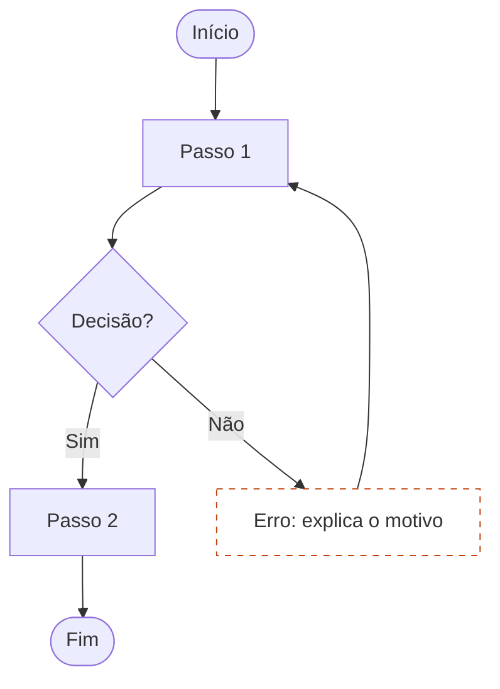

# Diagramação de fluxo de tarefas

## Convenções (as mesmas da folha oficial)
| Elemento | Forma | Mermaid | TikZ |
|---|---|---|---|
| Início / Fim | cápsula verde | `A([Início])` | `rounded rectangle` ou `rectangle, rounded corners=8pt` |
| Passo ou tela | retângulo azul | `B[Abrir app]` | `rectangle` |
| Decisão | losango laranja, saídas "Sim"/"Não" | `C{Botão ativo?}` | `diamond, aspect=2` |
| Erro / exceção | retângulo tracejado | `E[Sem conexão]:::erro` | `dashed` |

## Regras
1. Os passos seguem a ordem da HTA (skill `analise-cognitiva`).
2. Toda decisão tem as duas saídas rotuladas (`-->|Sim|`, `-->|Não|`).
3. Todo ramo de erro **volta** a um passo anterior (ou termina explicitamente) e diz o que fazer.
4. No rodapé: total de passos (retângulos), de decisões (losangos) e a resposta a "o erro explica o que fazer?".

## Modelo Mermaid

## Em LaTeX
TeX Live não renderiza Mermaid: desenhe o mesmo grafo em TikZ (bibliotecas `shapes.geometric`, `positioning`, `arrows.meta`) e mostre o código Mermaid ao lado com `listings`, para que os dois batam.
